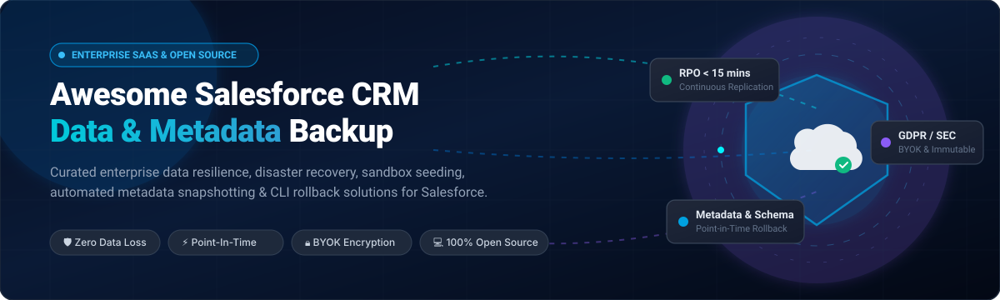

  

# 🛡️ Awesome Salesforce CRM Data & Metadata Backup

> 🚀 **A curated index of top-tier Salesforce CRM Data and Metadata Backup platforms** — spanning enterprise SaaS/Hosted commercial data protection solutions and community-driven open-source CLI utilities for safeguarding Salesforce standard/custom objects, files, Chatter feeds, metadata configurations, and schema definitions against data corruption, human error, ransomware, and compliance disasters.

---

## 📑 Table of Contents

- [🌐 Sector Overview & Market Dynamics](#-sector-overview--market-dynamics)
- [☁️ SaaS & Enterprise Hosted Platforms](#️-saas--enterprise-hosted-platforms)
  - [🏢 Enterprise Comparison Matrix](#-enterprise-comparison-matrix)
  - [🔍 In-Depth SaaS Solution Profiles](#-in-depth-saas-solution-profiles)
- [💻 Open-Source Software & CLI Tooling](#-open-source-software--cli-tooling)
  - [⭐ Open-Source Repositories Ranked by Community Stars](#-open-source-repositories-ranked-by-community-stars)
  - [🛠️ In-Depth Open-Source Tool Profiles](#️-in-depth-open-source-tool-profiles)
- [📊 Feature Comparison at a Glance](#-feature-comparison-at-a-glance)
- [💖 Support](#-support)
- [📈 Star History](#-star-history)
- [🤝 Contributing](#-contributing)
- [📄 License](#-license)

---

## 🌐 Sector Overview & Market Dynamics

The global **SaaS backup and data protection market** is valued at approximately **$4.5B–$6.0B** (with the dedicated Salesforce data protection segment alone surpassing **$1.8B** and expanding at a compound annual growth rate (**CAGR of ~16.5%**) toward **$5B+ by 2032**), driven by strict shared-responsibility models, SEC cyber disclosure mandates, and rising enterprise ransomware attacks. 

The sector is **moderately concentrated at the high-end enterprise tier**—anchored by dominant multi-billion-dollar infrastructure consolidators (e.g., Veeam, Commvault, and Salesforce's own $1.9B acquisition of Own/OwnBackup)—while remaining **vibrantly fragmented across the mid-market and developer DevOps ecosystem**, where specialized ISVs (Odaseva, Druva, Flosum) compete intensely on Bring-Your-Own-Key (BYOK) cryptography, multi-cloud compliance, and metadata CI/CD pipeline automation.

---

## ☁️ SaaS & Enterprise Hosted Platforms

Commercial, cloud-hosted Salesforce CRM Data and Metadata Backup platforms engineered for large-scale enterprise data resilience, automated RPO/RTO adherence, and sandbox management.

### 🏢 Enterprise Comparison Matrix

> Sorted descending by **Company Scale (Valuation / Market Capitalization / Parent Revenue)**:

| Platform | Company Scale (Valuation / Revenue) 🏢 | Pricing (Starting Paid Tier) 💳 | Free Tier / Trial Limit 🎁 | Deployment Architecture ⚙️ | Key Specialization 🎯 |
|---|---|---|---|---|---|
| **[Veeam Backup & Data Cloud for Salesforce](#veeam-backup-for-salesforce)** | **$15.0B Valuation** (~$2.0B ARR) | **$2.60 / user / mo** (Self-Hosted); **$4.17 / user / mo** (Managed Cloud) | **Free Forever** for up to **50 Salesforce user licenses** (Community Edition); 30-day enterprise trial | Self-Hosted (AWS, Azure, On-prem) or Managed SaaS | Full backup engine, PostgreSQL BYOS, 50-user free Community Edition |
| **[Commvault Cloud for Salesforce](#commvault-cloud-for-salesforce)** | **~$7.0B Market Cap** ($1.2B+ ARR) | **$3.60 / user / mo** (Annual billing) | **30-Day Free Trial** with full access to SaaS data protection & recovery workloads | Multi-Tenant Cloud / Commvault Metallic Cloud | Centralized multi-cloud enterprise protection, compliance locks & ransomware detection |
| **[CloudAlly Salesforce Backup (OpenText)](#cloudally-salesforce-backup)** | **~$6.0B Market Cap** (Parent OpenText, $5.1B Rev) | **$2.50 / user / mo** ($30 / user / year starting base tier) | **14-Day Free Trial** with full automated daily backup & unlimited AWS S3 retention | Managed Cloud (AWS S3) | Automated daily snapshots, unlimited retention, multi-SaaS unified console |
| **[AvePoint Cloud Backup for Salesforce](#avepoint-cloud-backup-for-salesforce)** | **~$3.5B Market Cap** ($465M+ ARR) | **£3.45 (~$4.35) / user / mo** (G-Cloud listed, min. seat bands) | **30-Day Free Trial / Proof-of-Concept** with sandbox seeding and restore drills | Managed Cloud / Multi-Cloud | Unlimited 4x/day replication, unlimited sandbox seeding, unified M365/Salesforce governance |
| **[Druva Salesforce Backup](#druva-salesforce-backup)** | **$2.0B Valuation** ($200M+ ARR) | **$3.50 / user / mo** (AppExchange Enterprise starting base) | **30-Day Free Trial** with full feature access across live org data & sandbox seeding | 100% Serverless Cloud (AWS native) | Air-gapped immutable AWS storage, automated GDPR erasure & data portability |
| **[Own (Formerly OwnBackup)](#ownbackup-own-for-salesforce)** | **$1.9B Acquisition Valuation** by Salesforce ($200M+ ARR) | **$1.95 / user / mo** (Base AppExchange entry tier) | **14-Day Free Trial** with full backup, visual org differencing & compare tools | Managed Cloud (Salesforce Native / AWS) | Salesforce-native market benchmark, visual line-by-line metadata compare |
| **[Spanning Backup (Kaseya)](#spanning-backup-for-salesforce)** | **$2.0B+ Parent Valuation** (Kaseya IT Complete) | **$4.00 / user / mo** ($48 / user / year standard tier) | **14-Day Free Trial** with full snapshot access via Salesforce AppExchange | Managed Cloud | Point-in-time restore, automated daily capture, optimized for MSPs |
| **[Odaseva Enterprise Data Protection](#odaseva-enterprise-data-protection)** | **$350M–$500M Est. Valuation** ($54M Series C) | **$5,000 / year** (Professional base tier, quote-based for LDV) | **No Free-Forever Plan**; tailored **Proof-of-Concept (POC)** & stress-test audit sandbox available | Multi-Cloud (AWS, Azure, Alibaba Cloud) | Patent-pending 5-level encryption, BYOK, ultra-large data volumes (LDV), China MLPS Level 3 |
| **[Flosum Data Backup & Archive](#flosum-data-backup)** | **$100M+ Est. Valuation** (~$10M+ ARR, Bootstrapped) | **$2.75 / user / mo** (Standalone backup add-on, custom quote) | **14-Day Free Trial** for Flosum Backup & Archive cloud tenant connection | 100% Salesforce Native (Azure/AWS BYOS) | Deep Git/DevOps release pipeline integration, data masking, zero data egress |

---

### 🔍 In-Depth SaaS Solution Profiles

#### 🛡️ Veeam Backup for Salesforce
- **Company Scale:** ~$15.0B Valuation / $2.0B+ ARR.
- **Starting Price:** $2.60/user/month (Self-Hosted); $4.17/user/month (Managed Cloud).
- **Free Tier Limits:** **Free forever for up to 50 active Salesforce users** (Community Edition); 30-day enterprise trial.
- **Architecture & Overview:** Provides autonomous data, metadata, and binary file protection. Admins can schedule granular backup intervals (down to 5 minutes) using Bulk API and REST API, with target databases running on local PostgreSQL, AWS RDS, or Azure Database.
- **Best For:** Small organizations wanting a permanent $0 backup solution (≤50 seats) or enterprises requiring on-premises/BYOC data sovereignty without vendor lock-in.

#### 🔒 Commvault Cloud for Salesforce
- **Company Scale:** ~$7.0B Market Capitalization (NASDAQ: CVLT).
- **Starting Price:** $3.60/user/month (annual billing).
- **Free Tier Limits:** 30-day enterprise free trial with full feature access.
- **Architecture & Overview:** Built on Commvault's Metallic AI security engine. Offers automated policy-driven protection across standard/custom objects, metadata configurations, chatter posts, and Knowledge articles, backed by immutable air-gapped cloud storage.
- **Best For:** Large enterprises already standardizing multi-cloud workloads on Commvault seeking a single pane of glass for compliance.

#### ☁️ CloudAlly Salesforce Backup (OpenText)
- **Company Scale:** ~$6.0B Market Cap (Parent OpenText, NASDAQ: OTEX).
- **Starting Price:** $2.50/user/month ($30/user/year entry tier).
- **Free Tier Limits:** 14-day free trial with unrestricted automated daily snapshots.
- **Architecture & Overview:** Enterprise-grade SaaS data protection that automates daily backups of Salesforce records, object schemas, metadata, Chatter, and attachments into secure AWS S3 storage with unlimited retention options.
- **Best For:** Organizations seeking reliable, cost-effective backup across Salesforce, M365, and Google Workspace under one contract.

#### 🌐 AvePoint Cloud Backup for Salesforce
- **Company Scale:** ~$3.5B Market Capitalization (NASDAQ: AVPT).
- **Starting Price:** £3.45 (~$4.35)/user/month (UK G-Cloud framework baseline).
- **Free Tier Limits:** 30-day free proof-of-concept trial.
- **Architecture & Overview:** Delivers automated backups running up to 4 times daily with multi-region Azure storage. Features comprehensive sandbox seeding, granular record-level rollback, and multi-tenant management.
- **Best For:** Mid-to-large organizations requiring unlimited 4x/day replication and enterprise sandbox seeding without data volume surcharges.

#### ⚡ Druva Salesforce Backup
- **Company Scale:** $2.0B Valuation / $200M+ ARR.
- **Starting Price:** $3.50/user/month (AppExchange listed base package).
- **Free Tier Limits:** 30-day free trial with live org testing and sandbox seeding.
- **Architecture & Overview:** 100% serverless, cloud-native architecture built on AWS. Backs up standard, custom, and managed package objects alongside metadata configurations, featuring automated GDPR "Right to Be Forgotten" erasure workflows.
- **Best For:** Cloud-first enterprises seeking zero infrastructure footprint, automated compliance features, and air-gapped ransomware protection.

#### 🏆 Own (Formerly OwnBackup)
- **Company Scale:** $1.9B Acquisition Valuation (Acquired by Salesforce in Sept 2024).
- **Starting Price:** $1.95/user/month (Entry-tier AppExchange baseline).
- **Free Tier Limits:** 14-day full-featured free trial.
- **Architecture & Overview:** The historical standard in Salesforce ecosystem protection. Offers high-speed incremental daily snapshots, line-by-line visual metadata differencing, automated relationship preservation during restores, and sandbox seeding.
- **Best For:** Teams wanting native Salesforce ecosystem synergy and visual diffing tools for sandbox management and disaster recovery.

#### 💼 Spanning Backup for Salesforce (Kaseya)
- **Company Scale:** $2.0B+ Parent Company Valuation (Kaseya).
- **Starting Price:** $4.00/user/month ($48/user/year base).
- **Free Tier Limits:** 14-day free trial via Salesforce AppExchange.
- **Architecture & Overview:** Streamlined, admin-friendly daily automated backup engine with field-level compare, point-in-time recovery, and export capabilities.
- **Best For:** Managed Service Providers (MSPs) and mid-market Salesforce orgs wanting straightforward backup and recovery.

#### 🔐 Odaseva Enterprise Data Protection
- **Company Scale:** $350M–$500M Estimated Valuation ($54M Series C led by Silver Lake).
- **Starting Price:** $5,000/year (Professional tier base); custom quote for large enterprise volumes.
- **Free Tier Limits:** No free-forever plan; provides customized proof-of-concept (POC) sandbox stress tests.
- **Architecture & Overview:** Engineered for global Fortune 500 enterprises with tens of billions of records. Implements patent-pending 5-level Bring Your Own Key (BYOK) cryptography, Salesforce Shield native integration, and China data residency compliance via Alibaba Cloud.
- **Best For:** Regulated global financial institutions, healthcare providers, and enterprises operating Large Data Volumes (LDV).

#### 🚀 Flosum Data Backup & Archive
- **Company Scale:** $100M+ Estimated Valuation (~$10M+ ARR).
- **Starting Price:** $2.75/user/month (Standalone backup add-on module).
- **Free Tier Limits:** 14-day free trial upon tenant registration.
- **Architecture & Overview:** 100% native Salesforce architecture that ensures zero data leaves your cloud perimeter. Integrates directly into Flosum DevOps release pipelines for pre-deployment snapshots and instant rollbacks.
- **Best For:** DevOps-heavy engineering teams wanting backup and disaster recovery directly wired into their Salesforce CI/CD pipelines.

---

## 💻 Open-Source Software & CLI Tooling

Open-source Salesforce data and metadata utilities are community-driven tools engineered primarily for **metadata versioning, rollback, schema documentation, and automated CI/CD extraction**.

> [!NOTE]
> Because Salesforce limits REST/Bulk API query volumes and charges for storage infrastructure, production record-level data protection at scale is dominated by SaaS platforms. Open-source solutions provide developer-friendly control over metadata snapshots, Git automation, and local database exports.

### ⭐ Open-Source Repositories Ranked by Community Stars

> Each Stars_Badge links directly to that repository's stargazers page:

| Repository & Tool | Community GitHub_Stars ⭐ | Primary Tech Stack 💻 | License 📜 | Data Backup 💾 | Metadata Backup 📄 | Self-Hosted 🏠 |
|---|---|---|---|---|---|---|
| **[sfdx-hardis](#sfdx-hardis)** |  | TypeScript / SF CLI | MIT License | ⚠️ Masked Sandboxes | ✅ Full Scheduled | ✅ Local / CI |
| **[StratoSource](#stratosource)** |  | Java / Salesforce API | Apache-2.0 | ❌ No | ✅ Version Control | ✅ Self-Hosted |
| **[force-meta-backup](#force-meta-backup)** |  | Ant / Shell / Java | Open Source | ❌ No | ✅ Ant XML Pull | ✅ Local CLI |
| **[salesforceMetadataBackup](#salesforcemetadatabackup)** |  | PHP / Ant / REST API | MIT License | ❌ No | ✅ Git Auto-Push | ✅ Local / Server |
| **[heimdall](#heimdall)** |  | Go / Salesforce API | MIT License | ✅ Point-in-Time | ✅ Archive | ✅ Self-Hosted |
| **[backup-force.com](#backup-forcecom)** |  | Python / REST API | Apache-2.0 | ✅ Local SQLite/CSV | ✅ Schema | ✅ Local CLI |
| **[metadata-backup](#metadata-backup)** |  | Python / Metadata API | MIT License | ❌ No | ✅ Full Org Pull | ✅ Local Script |
| **[sfdcCommander](#sfdccommander)** |  | Java / Desktop App | GPL-3.0 | ✅ Local SQLite | ✅ XML Download | ✅ On-Premise |
| **[force-backup-automator](#force-backup-automator)** |  | Python | MIT License | ✅ Weekly Export DL | ❌ No | ✅ Local / Cron |
| **[sfdc-backup](#sfdc-backup)** |  | Python 3 / Bulk API | MIT License | ✅ Queryable Bulk | ❌ No | ✅ Local / Container |
| **[sf-schema-snapshot](#sf-schema-snapshot)** |  | Python / SQLite | MIT License | ❌ No | ✅ Schema & Rules | ✅ Local CLI |
| **[sf-metadata-backup](#sf-metadata-backup)** |  | TypeScript / SF CLI | MIT License | ❌ No | ✅ Rollback Tarball | ✅ Local CLI |

---

### 🛠️ In-Depth Open-Source Tool Profiles

#### 🧰 [sfdx-hardis](https://github.com/hardisgroupcom/sfdx-hardis)

- **Stack:** TypeScript / Salesforce CLI (`sf` / `sfdx`)
- **License:** MIT License
- **Features:** A comprehensive "Swiss-army knife" for Salesforce developers and DevOps engineers. Automates end-to-end CI/CD pipelines, generates AI-powered org documentation, and executes scheduled daily metadata backups and change-monitoring directly into Git repositories.
- **Best For:** Teams wanting an actively maintained, all-in-one CLI toolbox for automated Git-backed metadata protection and org monitoring.

#### 🔄 [StratoSource](https://github.com/StratoSource/StratoSource)

- **Stack:** Java / Salesforce Tooling & Metadata APIs
- **License:** Apache-2.0
- **Features:** Complete Salesforce backup, release management, and version-tracking platform. Automatically retrieves all org metadata, parses components into human-readable source structures, and commits updates to local and remote Git repositories.
- **Best For:** Enterprise developers needing a standalone server to synchronize Salesforce configurations with Git version control.

#### 📦 [force-meta-backup](https://github.com/alan-morey/force-meta-backup)

- **Stack:** Apache Ant / Shell / Java
- **License:** Open Source
- **Features:** Automates the extraction of all available Salesforce metadata by dynamically constructing `package.xml` manifests and invoking the Salesforce Migration Tool (Ant).
- **Best For:** Administrators comfortable with traditional Ant tooling wanting zero-configuration full metadata downloads.

#### 🐙 [salesforceMetadataBackup](https://github.com/danieljpeter/salesforceMetadataBackup)

- **Stack:** PHP / Salesforce REST API / Apache Ant
- **License:** MIT License
- **Features:** Queries Salesforce metadata descriptions, generates dynamic `package.xml` files, retrieves metadata zips, unpacks them into a repository directory, and automatically commits and pushes diffs to GitHub.
- **Best For:** Lightweight server-side cron jobs tracking org configuration history in GitHub.

#### 🛡️ [heimdall](https://github.com/devrandom-se/heimdall)

- **Stack:** Go (Golang) / Salesforce REST & Streaming API
- **License:** MIT License
- **Features:** Self-hosted Salesforce backup engine written in high-performance Go. Features automated version history tracking, archival management, and point-in-time restore capabilities.
- **Best For:** Developers looking for a modern, compiled Go utility capable of handling both records and configuration histories.

#### 💾 [backup-force.com](https://github.com/neowit/backup-force.com)

- **Stack:** Python / Salesforce REST API
- **License:** Apache-2.0
- **Features:** Extracts and backs up Salesforce databases locally into SQLite files and CSV dumps. Queries all standard and custom objects, generating schema definitions and relationship structures.
- **Best For:** Data analysts and developers requiring local SQLite replicas of Salesforce orgs for offline SQL queries and testing.

#### 📁 [metadata-backup](https://github.com/mattandneil/metadata-backup)

- **Stack:** Python / Salesforce Metadata API
- **License:** MIT License
- **Features:** Python script designed to download every metadata item in a Salesforce organization, providing a snapshot for version control and compliance auditing.
- **Best For:** Quick Python-based snapshots of org metadata definitions.

#### 🖥️ [sfdcCommander](https://github.com/jwiesel/sfdcCommander)

- **Stack:** Java (Swing GUI / CLI)
- **License:** GNU General Public License v3.0
- **Features:** Comprehensive desktop administrative suite. Includes a **Database-Backup** feature that dumps complete org records into an SQLite database, a metadata downloader requiring no `package.xml` preparation, and technical documentation generators.
- **Best For:** Admins preferring a graphical desktop application for creating local SQLite data snapshots and schema exports.

#### ⏰ [force-backup-automator](https://github.com/stefanzepeda/force-backup-automator)

- **Stack:** Python / Selenium / Requests
- **License:** MIT License
- **Features:** Automates the downloading and extraction of native Salesforce Weekly Data Export zip files, overcoming the manual download expiration limits enforced by Salesforce.
- **Best For:** Teams relying on Salesforce's built-in Weekly Export Service who need automated cron-based archive retention.

#### 🚀 [sfdc-backup](https://github.com/joecheng511/sfdc-backup)

- **Stack:** Python 3 / Salesforce Bulk API 2.0 / REST API
- **License:** MIT License
- **Features:** Efficient Python solution that backs up all queryable record data from a Salesforce organization using Bulk API 2.0. Outputs structured JSON/CSV files while respecting API limits.
- **Best For:** Developers needing an automated batch pipeline to dump table records into cold cloud storage (S3/GCS).

#### 🔍 [sf-schema-snapshot](https://github.com/MogwaiNerfHerder/sf-schema-snapshot)

- **Stack:** Python / SQLite
- **License:** MIT License
- **Features:** Dumps an org's entire data model (objects, custom fields, relationships, validation rules, Apex triggers, and Organization-Wide Defaults) into a self-documenting SQLite database in minutes.
- **Best For:** RevOps teams, CRM architects, and LLM coding agents needing a queryable SQL schema graph for org discovery and documentation.

#### ⏪ [sf-metadata-backup](https://github.com/lebarion/sf-metadata-backup)

- **Stack:** TypeScript / Salesforce CLI plugin
- **License:** MIT License
- **Features:** Salesforce CLI plugin dedicated to pre-deployment safety. Creates `.tar.gz` archive snapshots of metadata before deployments and generates instant destructive change manifests for one-line rollback (`sf backup rollback`).
- **Best For:** Salesforce developers looking for quick pre-deployment safety nets and automated rollbacks during release cycles.

---

## 📊 Feature Comparison at a Glance

| Solution | Deployment | Data Records 💾 | Metadata Config 📄 | Files & Chatter 📎 | Sandbox Seeding 🌱 | Free Tier Option 🎁 | Target Audience 🎯 |
|---|---|:---:|:---:|:---:|:---:|:---:|---|
| **Veeam** | Self-Hosted / SaaS | ✅ | ✅ | ✅ | ✅ | ✅ Free ≤50 Users | Small orgs, Banks & Private Cloud |
| **Commvault** | Cloud SaaS | ✅ | ✅ | ✅ | ✅ | 30-Day Trial | Multi-cloud enterprise customers |
| **CloudAlly** | Cloud SaaS | ✅ | ✅ | ✅ | ✅ | 14-Day Trial | Cost-conscious mid-market & M365 orgs |
| **AvePoint** | Cloud SaaS | ✅ | ✅ | ✅ | ✅ | 30-Day Trial | Teams with intensive sandbox needs |
| **Druva** | Cloud SaaS (AWS) | ✅ | ✅ | ✅ | ✅ | 30-Day Trial | Serverless-first enterprise compliance |
| **Own (OwnBackup)** | Cloud SaaS (Native) | ✅ | ✅ | ✅ | ✅ | 14-Day Trial | Salesforce-first enterprises & DevOps |
| **Spanning** | Cloud SaaS | ✅ | ✅ | ✅ | ❌ | 14-Day Trial | MSPs & mid-sized businesses |
| **Odaseva** | Cloud SaaS (Multi-Cloud) | ✅ | ✅ | ✅ | ✅ | POC Sandbox | Ultra-large volume (LDV) & regulated orgs |
| **Flosum** | Native Salesforce | ✅ | ✅ | ✅ | ✅ | 14-Day Trial | Salesforce DevOps & release managers |
| **sfdx-hardis** | Self-Hosted CLI / CI | ⚠️ Masked | ✅ | ❌ | ⚠️ Scripted | ✅ 100% Free Open-Source | Salesforce developers & DevOps engineers |
| **heimdall** | Self-Hosted (Go) | ✅ | ✅ | ❌ | ❌ | ✅ 100% Free Open-Source | Self-hosters & Go engineers |
| **sf-metadata-backup** | Local SF CLI Plugin | ❌ | ✅ Rollback | ❌ | ❌ | ✅ 100% Free Open-Source | Developers wanting pre-deploy safety |
| **backup-force.com** | Local Python Script | ✅ SQLite | ✅ Schema | ❌ | ❌ | ✅ 100% Free Open-Source | Local SQL reporting & offline audits |
| **sf-schema-snapshot** | Local Python Script | ❌ | ✅ Schema | ❌ | ❌ | ✅ 100% Free Open-Source | CRM architects & RevOps data modeling |

---

## 💖 Support

A huge thank you to everyone exploring, evaluating, and contributing to this curated repository! If you find this project helpful for your organization's Salesforce disaster recovery, backup strategies, or metadata management:

- ⭐ **Star this repository** to help others discover it across GitHub.
- 🍴 **Fork and share** it with your developer, admin, and architect colleagues.
- ☕ **Support the maintainer:** If this saved you time or research hours, consider buying a coffee or sponsoring ongoing open-source maintenance via the **[GitHub Sponsors Dashboard](https://github.com/sponsors/ishandutta2007)**!

---

## 📈 Star History

---

## 🤝 Contributing

Contributions are warmly encouraged! If you know of an outstanding open-source tool, CLI plugin, or enterprise platform for Salesforce data and metadata recovery, please submit a pull request:

1. 🍴 Fork the repository.
2. 🌿 Create a descriptive branch: `git checkout -b add-tool-name`.
3. 📝 Add your project with links, category tags, pricing/license details, and GitHub Stars_Badges (`style=social&color=white`).
4. 🚀 Open a Pull Request!

---

## 📄 License

This repository and curated list are released under the [Creative Commons Zero v1.0 Universal License (CC0 1.0)](LICENSE). All referenced trademarks, product names, logos, and repository links belong to their respective owners.

  Built with ❤️ for the Salesforce Admin, Developer &amp; Data Resilience Community. ⭐ Star if you find this valuable!

